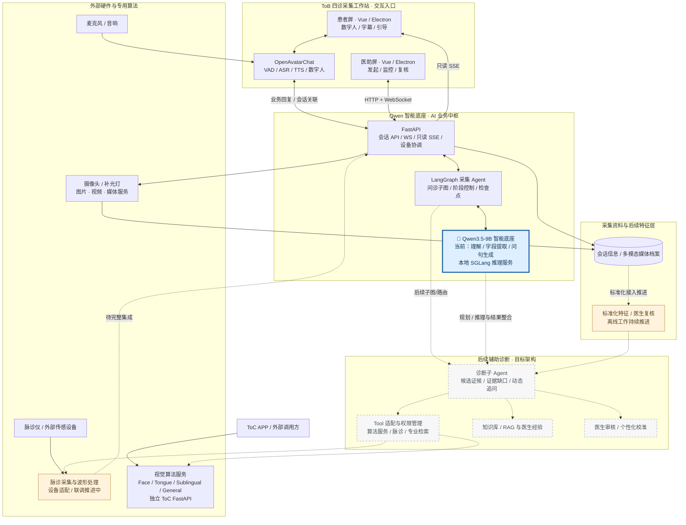

# 🩺 中医多模态 AI 系统｜从 PPT 方案到产品原型的 0→1 落地

**主导项目软件从方案走向可运行产品：以 ToB 四诊采集工作站为核心，完成数字人问诊、双屏协同与多模态采集系统集成，并推进 ToC 视觉算法服务化。**

这份作品集记录了我负责中医四诊系统软件落地的过程：从梳理实际接诊场景、确定技术路线，到组织模块开发、跨服务联调和原型交付。项目主要使用 **Python / FastAPI、Vue 3 / Electron、Qwen3.5-9B / SGLang、LangGraph、OpenAvatarChat、Docker / Linux**。重点不是单一模型或算法，而是让多种能力在同一产品流程中稳定协作。

> **我的职责**：负责软件产品从 0 到 1 的需求梳理、架构设计、技术选型与开发推进，组织各模块对接、联调和交付。代码实现结合 AI Coding 和团队协作；面舌算法及传感硬件由项目团队共同研发。

## 🎯 01｜项目背景：从方案走向产品

**项目起点**：团队最初在项目方案中提出了纳米传感四诊采集、数字人交互和名医辅助诊断的平台设想。虽然已有面诊、舌诊等算法 Demo 和部分硬件基础，但它们各自运行，还不是一套能让患者完成检查、医助全程操作的产品。

**我负责的任务**：把 PPT 里的平台设想拆解成可开发、可交付的软件产品。没有一开始就追求完整的自动诊断，而是先让四诊信息采集、数字人交互和医生辅助操作在一台工作站上跑通，同时将已有视觉算法改造成可复用的 API 服务。

| 路线 | 目标 | 实际范围 |
| --- | --- | --- |
| **ToB 四诊采集工作站（主线）** | 在实体工作站实现患者引导、医助监控、智能问诊、多模态采集和会话归档 | 双屏数字人交互、多轮问诊、面舌采集、医助复核和数据归档已形成产品原型；脉诊仪接入与波形联动持续完善 |
| **ToC：视觉算法 API 服务化** | 将原有文件式算法 Demo 改造为可复用、可部署的推理服务 | 负责服务接口、模型生命周期和多服务部署的工程化思路与落地 |

产品落地按 **四诊采集 → 特征标准化与医生标注 → 辅助诊断 Agent** 逐步推进。第一阶段优先解决医患交互、设备协同和数据归档，后续再围绕真实采集数据完善标准化与个性化辅助诊断。

## 🛠️ 02｜核心工作：把独立模块整合成系统

| 负责方向 | 具体做法 | 要解决的问题 |
| --- | --- | --- |
| **产品与前端交互** | Electron 单应用双窗口，分别服务患者和医助；Vue 管理两端交互，医助 WebSocket 控制、患者只读 SSE 观察 | 角色分工、跨屏状态一致性和人工接管 |
| **AI 工作流** | 使用 LangGraph 编排受约束多轮问诊、采集子图、状态检查点、暂停/补采；Qwen 负责抽取与自然问句 | 多阶段流程可控、会话数据累计、异常可追踪 |
| **数字人和模型服务** | OpenAvatarChat 接入 VAD/ASR/TTS/数字人链路；FastAPI 连接业务图与 SGLang 本地 Qwen 推理 | 让数字人交互、业务状态和模型推理解耦 |
| **多模态与部署** | 摄像头按会话复用、业务与媒体入口分流、媒体归档；独立服务部署及健康检查 | 连续采集、视频回看和多组件部署维护 |
| **视觉算法工程化** | 将文件路径/重复模型加载方式调整为启动预加载、预热、内存传递和模型实例复用 | 降低重复初始化和磁盘 I/O 对连续 API 调用的影响 |

[整体系统架构、数字人链路、四诊采集流程](docs/architecture.md) · [技术选型理由与 Trade-off](docs/design-decisions.md)

### 🏗️ 整体架构：Qwen 底座、采集 Agent 与专业 Tool

以 **Qwen 智能底座**为核心，通过 **LangGraph 采集 Agent + FastAPI**连接 ToB 四诊采集工作站、独立视觉算法服务与外部传感设备，并向标准化特征、诊断子 Agent 和个性化辅助诊疗扩展。

**图示说明**：实线呈现已具备的软件交互与独立服务，虚线连接持续集成或规划的能力。脉诊仪作为专业采集设备接入平台，诊断子 Agent 将进一步整合标准化四诊特征、算法 Tool 与医生经验。

[查看分层架构与数字人调用链](docs/architecture.md) · [技术选型与取舍](docs/design-decisions.md)

## 🚀 03｜交付成果

- **🩺 ToB 四诊采集工作站**：在约三个月的集中开发中，推动核心业务从方案走到可运行的双屏原型。患者端由数字人引导问诊和面舌采集，医助端负责流程控制、采集监控、资料回看和人工接管；脉诊设备接入及波形联动继续完善。
- **⚡ ToC 算法服务化**：把原先依赖本地文件、重复加载权重的舌诊等算法封装为常驻推理 API，调整模型加载、图片传递与部署方式，让独立算法能够接入应用。早期代表性业务调用体验从**约 20 秒降至约 3 秒**（历史体验记录，非标准压测）。
- **📚 特征标准化与标注体系**：针对不同医生、算法对同一体征表述不一致的问题，参考《证素辨证学》和国家标准整理特征术语，探索语义检索、同义归并与医生复核流程。相关特征库和标注方案已开展建设，正逐步与采集业务衔接。
- **🔧 工程问题处理**：在实际联调中先后处理了跨屏流程误触发、媒体预览等待、问诊状态恢复和数字人播报时序等问题，让采集流程更连贯，也让异常更容易定位和处理。

### 🩺 ToB 四诊采集工作站 · 现场与采集流程

*四诊工作站现场素材。系统面向患者引导、医助操作和多模态采集协同，将早期方案中的独立模块整合到统一工作流程。*

**采集流程视频**

[▶ 查看采集系统 2× 加速演示](assets/%E9%87%87%E9%9B%86%E7%B3%BB%E7%BB%9F%E6%BC%94%E7%A4%BA2x.mp4)

*2× 加速演示：展示数字人交互与四诊采集工作流。*

### 📱 ToC 应用场景 · 算法服务化

*早期 PPT 中的移动端应用场景与报告界面，用于展示视觉算法 API 的下游使用方式。ToC 服务化以独立算法接口为核心，不将页面方案等同于完整 APP 已交付。*

### 🧠 辅助诊断与医生个性化（后续方向）

| 为什么采用 Agent 架构 | 诊断子 Agent 的目标工作流 |
| :---: | :---: |
|  |  |
| 通过工作流把模型推理、专业工具和人工审核分开，而非直接让单一模型包办全部任务 | 在采集数据与标准化特征的基础上，逐步实现候选判断、证据补充和专业工具调用 |

*以上为项目 PPT 中的技术方案示意。当前已落地的是采集工作流和独立专业算法服务，诊断子 Agent 属于后续建设方向。*

**医生个性化数字孪生方案**

*方案配图：在共享 Qwen 能力底座上，围绕不同医生的特征关注与经验形成差异化辅助诊断策略。这是后续平台方向，不是已经上线的名医诊断服务。*

## ⚙️ 04｜工程问题与优化

| 遇到的问题 | 如何处理 | 改进效果 / 当前进展 |
| --- | --- | --- |
| **算法响应慢** | 把模型加载移到服务启动阶段，复用权重和图片预处理，减少文件读写 | 代表性业务体验约 20s → 3s，仍待规范化复测 |
| **患者屏重连影响流程** | 拆分流程执行和状态订阅，患者屏只负责观察进度 | 避免订阅重连误触发流程推进 |
| **连续采集时预览卡顿** | 将图片/视频流与业务请求分流，共享采集缓冲 | 缓解浏览器长连接竞争，需继续进行实机回归 |
| **问诊中断后状态异常** | 修正子图暂停、恢复和字段保留逻辑 | 减少恢复时丢失已采信息的问题 |
| **数字人响应等待** | 对齐语音识别、两次模型调用与播报时序，排查重复请求 | 完成链路分析和部分时序调整，整体时延仍待优化 |

[查看工程问题的完整复盘](docs/engineering-cases.md) · [为何选择这些技术](docs/design-decisions.md)

## 🔍 05｜技术详情

- [架构与数据流](docs/architecture.md)：系统分层、数字人语音/模型调用、四诊采集和人工操作。
- [工程案例](docs/engineering-cases.md)：真实现象 → 任务 → 处理方案 → 结果与限制。
- [技术选型](docs/design-decisions.md)：Electron、IPC/WS/SSE、LangGraph、SGLang、OAC、FastAPI、Linux/Docker 的设计理由和代价。

**发展方向**：在现有 ToB 四诊采集工作站和 ToC 专业算法服务基础上，进一步建设特征标准化、诊断子 Agent 与医生个性化辅助决策闭环。
