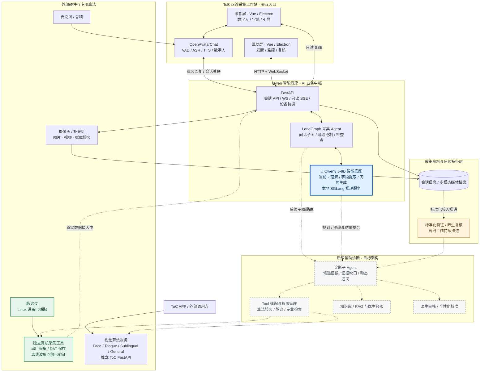

<h1>🩺 中医多模态 AI 系统</h1>

<strong>主导软件产品从 PPT 方案到双屏工作站的 0→1 落地</strong>

Qwen3.5-9B + LangGraph 驱动问诊采集，OpenAvatarChat 负责数字人交互，FastAPI 整合业务流程与专业视觉算法服务。

  <code>Python / FastAPI</code> ·
  <code>Vue 3 / Electron</code> ·
  <code>Qwen / SGLang</code> ·
  <code>LangGraph</code> ·
  <code>OpenAvatarChat</code> ·
  <code>Docker / Linux</code>

---

## 🎯 01｜项目概况与个人职责

项目最初具备面诊、舌诊等独立算法与硬件基础，但缺少面向真实接诊场景的统一软件产品。我负责软件需求拆解、系统架构、技术选型、开发统筹与跨模块联调；与团队协作，在约三个月的集中开发中推动 **ToB 四诊采集工作站原型**落地，并推进 **ToC 视觉算法 API 服务化**。

**个人工作重点**：设计患者/医助双屏业务流程，集成数字人、Qwen 与 LangGraph 问诊采集链路；推进视觉算法服务化、跨服务数据通信、状态恢复及 Linux/Docker 部署。面舌算法和传感硬件由项目团队共同研发。

## 🛠️ 02｜核心技术与系统架构

| 工作方向 | 关键实现 |
| --- | --- |
| **双屏交互与会话控制** | Vue 3 + Electron 双窗口；医助 WebSocket 控制、患者 SSE 只读订阅，IPC 处理本机窗口操作 |
| **AI 问诊与数字人** | LangGraph 管理多轮问诊、阶段路由与检查点；Qwen 负责信息提取和问句生成；OpenAvatarChat 集成语音及数字人 |
| **视觉算法工程化** | FastAPI 常驻推理服务、模型预加载与实例复用、图片内存传递，Docker 统一管理多个算法服务 |
| **采集与部署** | 摄像头会话复用、媒体与业务入口分离、采集资料归档及 Linux 多组件联调 |

### 🏗️ 整体系统架构

实线表示已具备的组件交互，虚线表示接入中或后续能力。详细调用链见 [系统架构与数据流](docs/architecture.md)。

## 🚀 03｜交付成果

### 🩺 ToB 四诊采集工作站

形成可运行的**患者端 + 医助端双屏原型**：数字人引导多轮问诊、面舌采集；医助端完成流程控制、采集监控、资料回看和人工接管。脉诊仪已完成 Linux 真机适配与独立采集验证，正在衔接工作站会话流程。

  

医院试用现场 · 双屏工作站与采集环境

**采集系统演示（2× 加速）**

https://github.com/user-attachments/assets/4eb2a0f3-a9b4-4c57-9e02-ff123c23c523

### ⚡ ToC 视觉算法服务化

将舌诊等文件式算法整理为可复用的推理 API，通过模型常驻、预热和内存数据流减少重复加载及文件 I/O。**代表性业务调用体验由约 20 秒缩短到约 3 秒**（开发阶段记录，非标准压测）。

  

移动端应用场景示意 · 视觉算法 API 的下游应用方向

### 📚 临床特征标准化与标签检索

基于《证素辨证学》与 GB/T 16751.2—2021 整理中医临床特征，构建 **110 个候选观察维度、510 个参考标签、681 条主检索表达**，另整理 **5,209 条扩展检索候选**。按“维度—状态”组织标签，例如「寒热」对应恶风、恶寒、潮热；疼痛按部位、性质分别归类。

| 检索表达 | 维度 | 关联的候选标签 |
| --- | --- | --- |
| 寒热往来 | 寒热 | 往来寒热 |
| 高热 | 寒热 | 壮热 |
| 声重 | 声音与言语 | 声音重浊 |

结合 Embedding 候选召回与 LLM 辅助术语整理，服务于医助的分类浏览、候选检索和结构化标注。

<strong>🧠 查看辅助诊断 Agent 与名医数字孪生方案</strong>

以下图片展示后续辅助诊断平台的设计方向，不代表现阶段已上线的自动诊断功能。

<table>
  <tr>
    <td align="center" width="50%"></td>
    <td align="center" width="50%"></td>
  </tr>
</table>

  

## ⚙️ 04｜工程问题与优化

| 实际问题 | 处理方式 |
| --- | --- |
| **双屏重连导致流程误推进** | 将患者 SSE 订阅改为只读观察，业务推进与状态订阅解耦 |
| **媒体预览卡顿** | 分离媒体与业务请求入口，按会话复用摄像头与帧缓冲 |
| **问诊中断后状态异常** | 修正 LangGraph 子图的暂停、检查点及恢复逻辑，保留已采集信息 |
| **数字人响应等待** | 拆解 VAD、ASR、LLM、TTS 调用链并修正阶段播报时序，持续优化交互体验 |

[查看真实问题、代码路径与技术取舍](docs/engineering-cases.md)

## 🔍 05｜技术详情

- [系统架构与数据流](docs/architecture.md)：整体架构、数字人调用链及采集流程
- [工程实践案例](docs/engineering-cases.md)：算法服务化、双屏通信、媒体资源与问诊状态恢复
- [技术选型与设计理由](docs/design-decisions.md)：Electron、LangGraph、SGLang、OpenAvatarChat、FastAPI 与 Docker

> 本项目展示软件产品和工程落地经历；医疗诊断 Agent、名医个性化能力属于后续研发方向。
