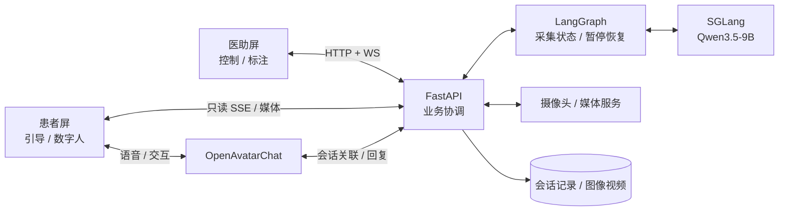

# 中医多模态四诊采集系统｜AI 全栈与 Agent 工程作品集

**从科研算法 Demo 到可运行的双屏 AI 工作站：主导软件产品定义、系统架构、模型服务化与软硬件集成落地。**

面向 **AI 全栈 / 大模型应用 / Agent 工程** 岗位，展示我在中医数字化科研项目中推进软件产品从方案到原型的真实工程实践。项目结合 **Python / FastAPI、Vue 3 / Electron、Qwen3.5-9B / SGLang、LangGraph、OpenAvatarChat、Docker / Linux**，同时包含独立的 ToC 视觉算法 API 服务化工作。

> **个人职责**：主导软件需求与架构决策、任务拆解、跨模块联调、方案审查和交付推进；具体编码结合 AI Coding、开源框架及团队协作。视觉模型、硬件传感器等专业研究成果不属于本人独立原创。本文仅展示经脱敏整理的工程案例，公开前仍需相关披露授权。

## 01｜项目背景与个人任务（STAR：S / T）

**Situation｜项目起点**：早期项目 PPT 描绘了融合四诊、数字人和个性化辅助诊断的中医数字化平台。研发初期已有面诊、舌诊等单独算法和部分设备原型，但输入输出、交互流程和存储分散，难以支持医助与患者协同完成一次真实采集。

**Task｜我的任务**：把“算法能跑”推进为“产品可用”。我主要承担两条技术路线：

| 路线 | 目标 | 实际范围 |
| --- | --- | --- |
| **ToB：四诊采集工作站（主线）** | 在实体工作站实现患者引导、医助监控、智能问诊、多模态采集和会话归档 | 负责软件产品与系统集成；脉诊仪的独立工具已可采集，但与工作站的完整接入仍在推进 |
| **ToC：视觉算法 API 服务化** | 将原有文件式算法 Demo 改造为可复用、可部署的推理服务 | 负责服务接口、模型生命周期和多服务部署的工程化思路与落地 |

我选择的交付路径是 **先构建稳定可追溯的四诊采集，再完善医生标注/特征标准化，最后探索个性化辅助诊断 Agent**；不把早期 PPT 的平台愿景写成当前已完成的自动诊断功能。

## 02｜关键行动（STAR：A）

| 负责方向 | 主要工程行动 | 解决的问题 |
| --- | --- | --- |
| **产品与前端交互** | Electron 单应用双窗口，分别服务患者和医助；Vue 管理两端交互，医助 WebSocket 控制、患者只读 SSE 观察 | 角色分工、跨屏状态一致性和人工接管 |
| **AI 工作流** | 使用 LangGraph 编排受约束多轮问诊、采集子图、状态检查点、暂停/补采；Qwen 负责抽取与自然问句 | 多阶段流程可控、会话数据累计、异常可追踪 |
| **数字人和模型服务** | OpenAvatarChat 接入 VAD/ASR/TTS/数字人链路；FastAPI 连接业务图与 SGLang 本地 Qwen 推理 | 让数字人交互、业务状态和模型推理解耦 |
| **多模态与部署** | 摄像头按会话复用、业务与媒体入口分流、媒体归档；独立服务部署及健康检查 | 连续采集、视频回看和多组件部署维护 |
| **视觉算法工程化** | 将文件路径/重复模型加载方式调整为启动预加载、预热、内存传递和模型实例复用 | 降低重复初始化和磁盘 I/O 对连续 API 调用的影响 |

[整体系统架构、数字人链路、四诊采集流程](docs/architecture.md) · [技术选型理由与 Trade-off](docs/design-decisions.md)

### 一图理解工作站

这张图只展示**已具备的软件主体**；脉诊仪完整工作站接入不画为已交付的自动闭环。更细的三层架构和数字人链路见 [架构页](docs/architecture.md)。

## 03｜落地结果（STAR：R）

- **工作站原型**：建立患者/医助双屏与问诊、面舌采集、媒体回看、会话归档等软件流程；支持基础标注、流程等待及人工介入。已形成工程原型和历史联调记录，当前没有可公开的完整实机验收视频。
- **ToC 推理服务**：舌诊等算法形成常驻推理 API 和多服务容器部署结构。根据开发阶段历史业务体验，代表性端到端调用由**约 20 秒缩短至约 3 秒**；旧新版模型加载及图像处理路径可由代码核对，但原始计时脚本/日志缺失，**不属于规范化性能压测**。
- **真实问题修复**：排查过 SSE 重连误推进工作流、浏览器媒体长连接竞争、问诊子图恢复及交互时序问题。具体设计变化与验证边界见下方工程案例。
- **继续推进**：中医特征标准化与医生复核处于研究和集成阶段；脉诊仪工作站闭环、个性化自动辨证及名医数字孪生 Agent **不作为已完成结果**。

## 04｜工程问题与优化案例

| 工程问题 | 处理方式与收获 | 当前证据 |
| --- | --- | --- |
| **算法服务化与响应优化** | 重复权重加载 / 文件 I/O → 模型常驻预热、实例复用与内存处理 | 有新旧源码对应；20s → 3s 为历史体验 |
| **双屏状态同步** | 将可能推进流程的事件订阅与患者屏只读 SSE 观察分离 | 有历史问题记录与现有调用链 |
| **媒体预览阻塞** | HTTP/1.1 长连接竞争 → 独立媒体入口与共享摄像头缓冲 | 有工程实现与局部检查，暂无统一提速基准 |
| **LangGraph 多轮恢复** | 修正子图暂停和恢复路径，避免重新进入入口丢失已采字段 | 有源码、开发记录及定向回归 |
| **数字人链路与响应体验** | 处理模型调用、播报完成同步、会话关联和交互时序；识别 VAD 重分段/重复请求和串行 LLM 调用的延迟来源 | 已有部分工程改造；整体低延迟优化仍待量化验收 |

[阅读工程案例的 STAR 复盘](docs/engineering-cases.md) · [为何选择这些技术](docs/design-decisions.md)

## 05｜产品与工程展示（素材预留）

真实素材将由本人在获授权并脱敏后陆续补充，不使用生成的假界面或虚构测试视频。

| 展示位 | 计划放入的真实材料 | 目前状态 |
| --- | --- | --- |
| **实体工作站** | 主机、双显示器、采集外设与运行场景照片 | 待上传 |
| **双屏交互** | 患者数字人画面 + 医助接诊/监控/回看截图 | 待上传 |
| **完整采集流程** | 实际问诊、面舌采集、人工接管和归档的脱敏视频 | 待上传 |
| **优化证据** | 旧版/新版服务调用链对照、获准公开的测试片段 | 待补充可核对材料 |

[素材规则与后续放置目录](assets/README.md)

## 06｜更多技术细节

- [架构与数据流](docs/architecture.md)：系统分层、数字人语音/模型调用、四诊采集和人工操作。
- [工程案例](docs/engineering-cases.md)：真实现象 → 任务 → 处理方案 → 结果与限制。
- [技术选型](docs/design-decisions.md)：Electron、IPC/WS/SSE、LangGraph、SGLang、OAC、FastAPI、Linux/Docker 的设计理由和代价。

**项目边界**：该作品展示的是 AI 辅助的**采集与交互系统工程实践**，不是已经完成临床验证的诊断产品。专业算法由团队提供，未公开患者信息、原始业务源码、模型权重、设备协议或内部服务地址。
