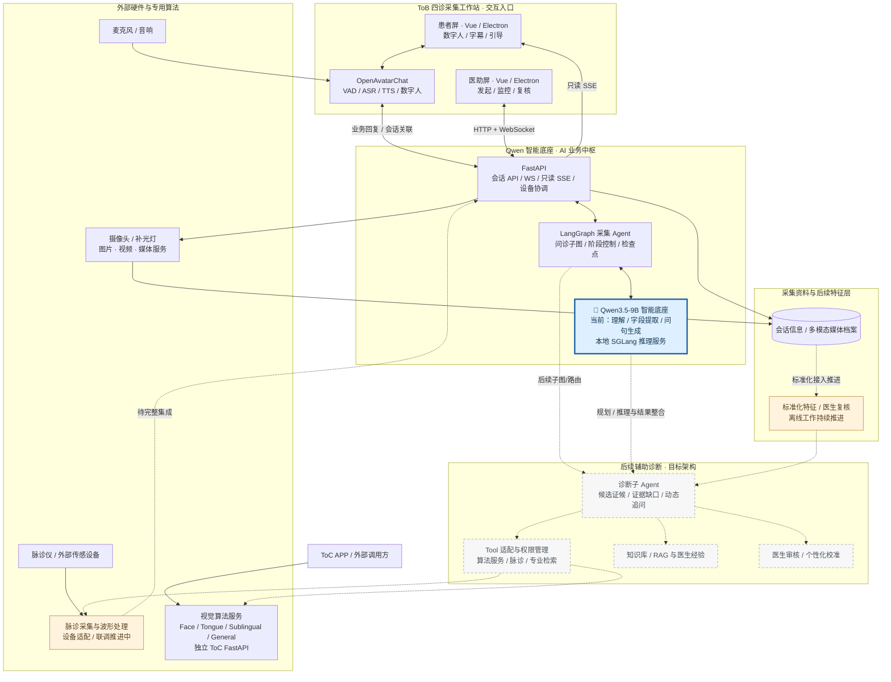

# 🩺 中医多模态 AI 平台｜ToB 四诊采集工作站 · ToC 算法服务

**从科研算法原型到实体产品落地：打造 ToB 四诊采集工作站与 ToC 算法服务体系，融合 Qwen 智能底座、数字人交互、多模态采集和专业算法能力。**

面向 **AI 全栈 / 大模型应用 / Agent 工程** 岗位，展示我在中医数字化项目中主导产品方案、软件架构、系统集成与工程交付的实践。项目结合 **Python / FastAPI、Vue 3 / Electron、Qwen3.5-9B / SGLang、LangGraph、OpenAvatarChat、Docker / Linux**，同时包含独立的 ToC 视觉算法 API 服务化工作。

> **个人职责**：主导软件需求与架构决策、任务拆解、跨模块联调、方案审查和交付推进；具体编码结合 AI Coding、开源框架及团队协作。视觉模型、硬件传感器等专业研究成果不属于本人独立原创。本文仅展示经脱敏整理的工程案例，公开前仍需相关披露授权。

## 🎯 01｜项目背景与产品定位

**项目起点**：早期项目 PPT 描绘了融合四诊、数字人和个性化辅助诊断的中医数字化平台。研发初期已有面诊、舌诊等单独算法和部分设备原型，但输入输出、交互流程和存储分散，难以支持医助与患者协同完成一次真实采集。

**职责与目标**：把“算法能跑”推进为“产品可用”。我主要承担两条技术路线：

| 路线 | 目标 | 实际范围 |
| --- | --- | --- |
| **ToB 四诊采集工作站（主线）** | 在实体工作站实现患者引导、医助监控、智能问诊、多模态采集和会话归档 | 双屏数字人交互、多轮问诊、面舌采集、医助复核和数据归档已形成产品原型；脉诊仪接入与波形联动持续完善 |
| **ToC：视觉算法 API 服务化** | 将原有文件式算法 Demo 改造为可复用、可部署的推理服务 | 负责服务接口、模型生命周期和多服务部署的工程化思路与落地 |

我选择的交付路径是 **先构建稳定可追溯的四诊采集，再完善医生标注/特征标准化，最后探索个性化辅助诊断 Agent**；不把早期 PPT 的平台愿景写成当前已完成的自动诊断功能。

## 🛠️ 02｜软件架构与核心建设

| 负责方向 | 主要工程行动 | 解决的问题 |
| --- | --- | --- |
| **产品与前端交互** | Electron 单应用双窗口，分别服务患者和医助；Vue 管理两端交互，医助 WebSocket 控制、患者只读 SSE 观察 | 角色分工、跨屏状态一致性和人工接管 |
| **AI 工作流** | 使用 LangGraph 编排受约束多轮问诊、采集子图、状态检查点、暂停/补采；Qwen 负责抽取与自然问句 | 多阶段流程可控、会话数据累计、异常可追踪 |
| **数字人和模型服务** | OpenAvatarChat 接入 VAD/ASR/TTS/数字人链路；FastAPI 连接业务图与 SGLang 本地 Qwen 推理 | 让数字人交互、业务状态和模型推理解耦 |
| **多模态与部署** | 摄像头按会话复用、业务与媒体入口分流、媒体归档；独立服务部署及健康检查 | 连续采集、视频回看和多组件部署维护 |
| **视觉算法工程化** | 将文件路径/重复模型加载方式调整为启动预加载、预热、内存传递和模型实例复用 | 降低重复初始化和磁盘 I/O 对连续 API 调用的影响 |

[整体系统架构、数字人链路、四诊采集流程](docs/architecture.md) · [技术选型理由与 Trade-off](docs/design-decisions.md)

### 🏗️ 整体架构：Qwen 底座、采集 Agent 与专业 Tool

以 **Qwen 智能底座**为核心，通过 **LangGraph 采集 Agent + FastAPI**连接 ToB 四诊采集工作站、独立视觉算法服务与外部传感设备，并向标准化特征、诊断子 Agent 和个性化辅助诊疗扩展。

**图示说明**：实线呈现已具备的软件交互与独立服务，虚线连接持续集成或规划的能力。脉诊仪作为专业采集设备接入平台，诊断子 Agent 将进一步整合标准化四诊特征、算法 Tool 与医生经验。

[查看分层架构与数字人调用链](docs/architecture.md) · [技术选型与取舍](docs/design-decisions.md)

## 🚀 03｜落地成果

- **🩺 ToB 四诊采集工作站**：完成双屏医患协同、数字人智能问诊、面舌多模态采集、媒体回看与会话归档等核心软件流程，支持医助监控、基础标注与人工接管；脉诊硬件及波形联动持续完善。
- **⚡ ToC 算法服务化**：将舌诊等视觉算法由独立 Demo 重构为常驻推理 API，采用模型预加载、预热、实例复用与内存数据传递，支持多服务容器化部署；开发阶段代表性业务调用体验**约 20 秒 → 3 秒**（历史记录，非标准压测）。
- **📚 特征标准化与标注体系**：结合《证素辨证学》和中医临床诊疗国家标准建立特征术语整理与同义归一方案，探索 LLM API、Embedding 语义匹配与人工复核，为四诊数据一致性和后续辅助诊断奠定数据基础；标准化能力仍在逐步集成。
- **🔧 工程稳定性优化**：围绕跨屏状态同步、媒体预览阻塞、LangGraph 会话恢复和数字人交互时序开展架构改进，提升系统集成和可维护性。

## ⚙️ 04｜工程问题与优化

| 工程问题 | 处理方式与收获 | 当前证据 |
| --- | --- | --- |
| **算法服务化与响应优化** | 重复权重加载 / 文件 I/O → 模型常驻预热、实例复用与内存处理 | 有新旧源码对应；20s → 3s 为历史体验 |
| **双屏状态同步** | 将可能推进流程的事件订阅与患者屏只读 SSE 观察分离 | 有历史问题记录与现有调用链 |
| **媒体预览阻塞** | HTTP/1.1 长连接竞争 → 独立媒体入口与共享摄像头缓冲 | 有工程实现与局部检查，暂无统一提速基准 |
| **LangGraph 多轮恢复** | 修正子图暂停和恢复路径，避免重新进入入口丢失已采字段 | 有源码、开发记录及定向回归 |
| **数字人链路与响应体验** | 处理模型调用、播报完成同步、会话关联和交互时序；识别 VAD 重分段/重复请求和串行 LLM 调用的延迟来源 | 已有部分工程改造；整体低延迟优化仍待量化验收 |

[阅读工程案例的 STAR 复盘](docs/engineering-cases.md) · [为何选择这些技术](docs/design-decisions.md)

## 🎬 05｜产品展示

真实素材将由本人在获授权并脱敏后陆续补充，不使用生成的假界面或虚构测试视频。

| 展示位 | 计划放入的真实材料 | 目前状态 |
| --- | --- | --- |
| **ToB 四诊采集工作站** | 主机、双显示器、采集外设与运行场景照片 | 待上传 |
| **双屏交互** | 患者数字人画面 + 医助接诊/监控/回看截图 | 待上传 |
| **完整采集流程** | 实际问诊、面舌采集、人工接管和归档的脱敏视频 | 待上传 |
| **优化证据** | 旧版/新版服务调用链对照、获准公开的测试片段 | 待补充可核对材料 |

[素材规则与后续放置目录](assets/README.md)

## 🔍 06｜技术详情

- [架构与数据流](docs/architecture.md)：系统分层、数字人语音/模型调用、四诊采集和人工操作。
- [工程案例](docs/engineering-cases.md)：真实现象 → 任务 → 处理方案 → 结果与限制。
- [技术选型](docs/design-decisions.md)：Electron、IPC/WS/SSE、LangGraph、SGLang、OAC、FastAPI、Linux/Docker 的设计理由和代价。

**发展方向**：在现有 ToB 四诊采集工作站和 ToC 专业算法服务基础上，进一步建设特征标准化、诊断子 Agent 与医生个性化辅助决策闭环。
