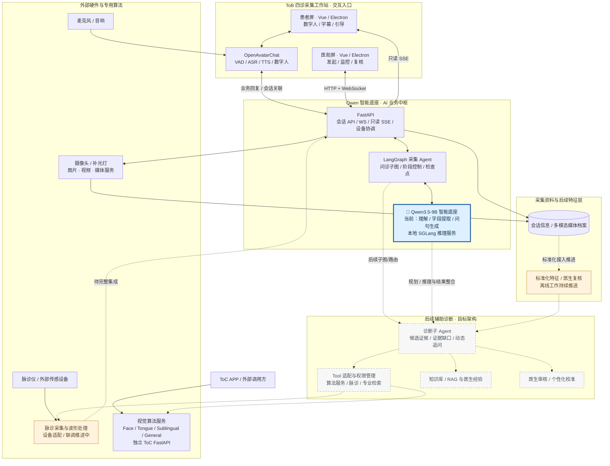
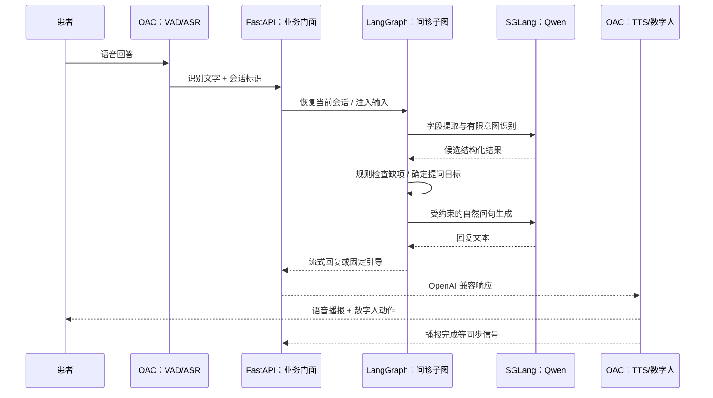
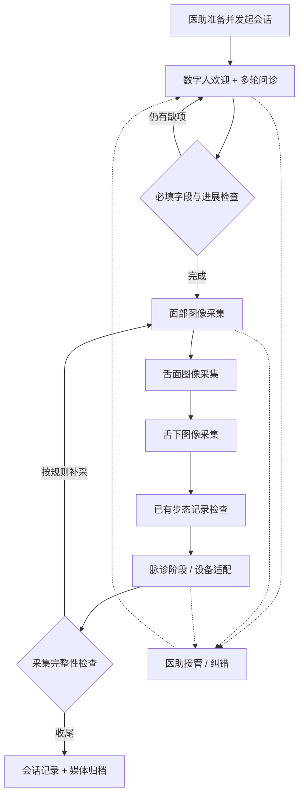
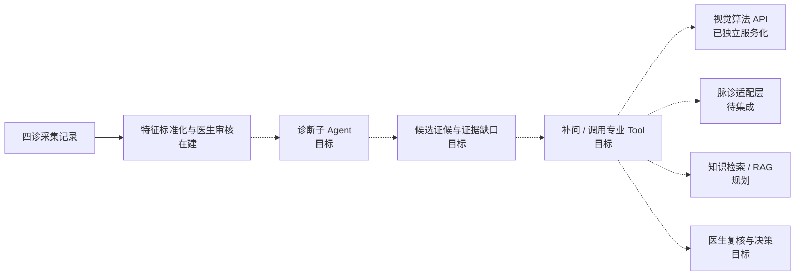

# 🏗️ ToB 四诊采集工作站｜系统架构与能力扩展

[返回作品集](../README.md) · [技术决策](design-decisions.md) · [工程案例](engineering-cases.md)

以 **ToB 四诊采集工作站**为核心，连接 Qwen 智能底座、双屏数字人交互、专业视觉算法服务及脉诊仪等外部设备，同时为诊断子 Agent 和个性化辅助诊疗预留能力扩展空间。**实线代表现有服务与数据流，虚线代表集成推进或后续规划。**

## 01｜整体架构：Qwen 底座、采集 Agent 与专业 Tool

**Qwen 底座的准确定位**：当前 Qwen 经 SGLang 为 LangGraph 提供问诊语义理解、字段提取和受约束问句生成；PPT 描述的**规划、工具调用、结果整合**是下一阶段 Diagnosis Agent 及业务编排的目标能力，不代表模型当前直接控制全部设备、调用全部算法或输出临床诊断。

**算法 Tool 的集成边界**：Face、Tongue、Sublingual、General 等 ToC 视觉 API 已具备独立部署与调用接口；它们不等于已经接入 LangGraph 的动态 Tool Calling。图中经 Tool 适配层的虚线体现**后续统一调用**，当前工作站仍主要通过自身采集流程及已有设备/服务接口协调。

**脉诊和外设**：工作站面向摄像头、麦克风、音响、补光灯和脉诊仪等多模态设备。脉诊模块具备独立采集基础，正推进通信数据质量、波形呈现和统一会话接入；后续可通过设备适配服务与标注体系联动。

**技术分工**：同机 Electron 双窗口不等于两台远程终端；窗口级操作走 IPC，医助双向控制走 WebSocket，患者状态观察走只读 SSE，图像与视频走独立媒体入口。业务状态由 FastAPI / LangGraph 协调，不由数字人独立决定。

## 02｜数字人语音、问诊与模型调用链

这是一轮典型问诊**逻辑路径**：按具体意图，固定提示、知识回复或主动引导可能走不同分支。VAD 判断语音结束，ASR 转文字，LLM 不直接处理全部音频。OAC 的兼容模型客户端连接的是**业务中枢提供的兼容门面**，而非把采集业务写入 OAC 或由数字人直接决定下一采集阶段。

**实际工程难点**：语音结束判断、ASR、非流式 NLU、下一问文本生成、TTS 和播报结束门控可能依次等待；VAD 重分段会造成一段用户回答产生多次请求。项目处理过问句重复、阶段播报与拍照争用的时序问题，也分析过串行调用造成的响应等待。**这里不声称已完成全链路低延迟改造或有可复核的端到端提速数值**。

## 03｜ToB 四诊采集工作站：业务流程与数据归档

- **已实现的软件基础**：主图串联采集阶段；问诊子图维护字段、意图、缺项与重试；面舌等子图按引导、等待、执行、质量检查组织流程，数据归档按同一会话关联。医助可监督、基础标注和接管。
- **暂停与恢复**：检查点保存 Graph 的业务状态，不能自动重建活动摄像头句柄、OAC 语音连接和全部设备状态。
- **脉诊特别说明**：图中的脉诊阶段包含设备接口和采集流程的衔接设计；独立脉诊采集已有基础，设备数据、波形展示与 ToB 四诊采集工作站的完整闭环仍在联调完善。
- **尚未交付**：标准特征匹配与个性化辅助诊断 Agent 的生产闭环、医学诊断报告与临床效果评估。

## 04｜下一阶段：诊断子 Agent 与 Tool 适配设计

目前的 ToB 四诊采集工作站先形成**会话关联的问诊、面舌图像、视频和人工标注**，后续逐步补入脉诊仪的真实波形特征。对接诊断子 Agent 的最小数据路径可以是：

这里**不是当前已经运行的自主诊断链路**。未来 Diagnosis Agent 的任务是基于标准化特征判断还需要哪类证据，并建议继续问诊或调用专业工具；由 LangGraph 管理授权、分支和人工审核，不让模型直接控制硬件。

### 脉诊设备接入的数据路径

`脉诊仪 → 采集与波形处理模块 → 设备适配接口 → 工作站会话关联 → 医助端实时显示 → 标注与归档`。

脉诊采集和设备适配已有工程基础，仍需完善数据完整性、波形显示与工作站会话级归档；脉象分析与诊断能力作为后续专业工具扩展。

### 独立 ToC 服务与平台 Tool 的关系

ToC 以 APP / 外部调用者为入口，向 **General、Face、Tongue、Sublingual** 等独立 FastAPI 服务发送请求，各服务维持自身模型生命周期并返回结构化结果，部署上由 Docker Compose 管理。

如果未来作为平台 Tool，先做**统一输入输出适配、超时/错误边界、会话关联和调用权限控制**，再由诊断子 Agent 通过业务编排访问这些接口。**独立 API 的完成，不等于已实现 Agent 的动态工具调用。**

## 05｜为什么不是一个“大模型包办所有功能”

ToB 四诊采集工作站采用**确定性业务骨架 + Qwen 语言能力 + 专业算法/设备服务 + 医助审核**：由 LangGraph 和代码规则控制采集阶段、缺项补问与暂停，大模型负责理解和受约束表达，采集算法/设备独立处理专业数据。后续才考虑在标准特征与医生复核基础上扩展证据缺口驱动的辅助诊断逻辑。

ToC 视觉算法 API 是**另一条产品工程路线**，具备独立服务化部署，不应画成工作站业务的必经调用。详见 [工程案例](engineering-cases.md)。
