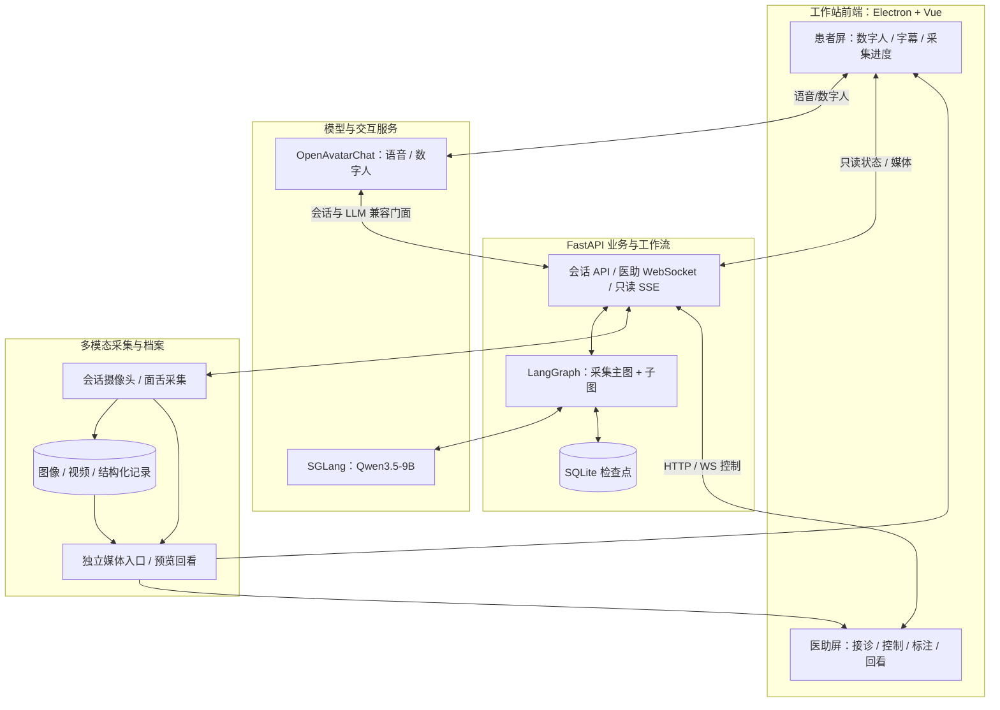
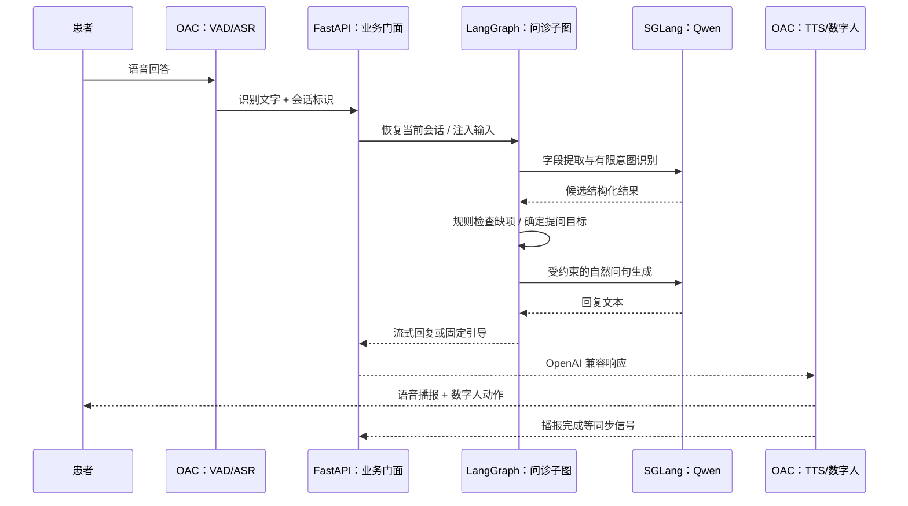
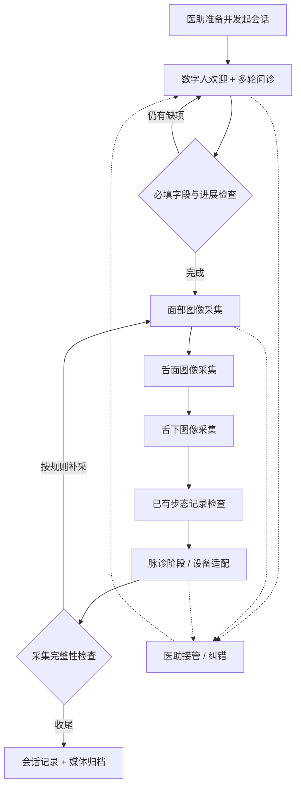

# 系统架构与数据流｜中医多模态 AI 采集工作站

[返回作品集](../README.md) · [技术决策](design-decisions.md) · [工程案例](engineering-cases.md)

本页展示当前**软件工作站**的分层与调用关系，来源于私有 TCM 项目架构和当前代码的脱敏整理。早期产品 PPT 中的名医数字孪生、端到端辨证、可穿戴医疗等属于团队长期目标，**不画入已交付系统**。

## 01｜整体系统架构：双屏 + 业务中枢 + 模型/设备

**设计理由**：单个 Electron 应用创建两个 `BrowserWindow`，患者端专注被动引导，医助端发指令和处理异常；两者不各自掌握一套业务状态。FastAPI 作为业务中枢，LangGraph 管理执行与检查点，数字人交互与推理容器独立部署，便于升级、定位与维护。

**协议分工**：Electron **IPC** 管本机窗口操作；**WebSocket** 用于医助端双向命令/反馈；患者端使用 **只读 SSE** 订阅活动会话与阶段；**媒体入口**承载预览、图片及录像。区分驱动与观察，避免界面重连导致业务流程误推进。

## 02｜数字人语音、问诊与模型调用链

这是一轮典型问诊**逻辑路径**：按具体意图，固定提示、知识回复或主动引导可能走不同分支。VAD 判断语音结束，ASR 转文字，LLM 不直接处理全部音频。OAC 的兼容模型客户端连接的是**业务中枢提供的兼容门面**，而非把采集业务写入 OAC 或由数字人直接决定下一采集阶段。

**实际工程难点**：语音结束判断、ASR、非流式 NLU、下一问文本生成、TTS 和播报结束门控可能依次等待；VAD 重分段会造成一段用户回答产生多次请求。项目处理过问句重复、阶段播报与拍照争用的时序问题，也分析过串行调用造成的响应等待。**这里不声称已完成全链路低延迟改造或有可复核的端到端提速数值**。

## 03｜四诊采集业务架构：状态、工具和归档

- **已实现的软件基础**：主图串联采集阶段；问诊子图维护字段、意图、缺项与重试；面舌等子图按引导、等待、执行、质量检查组织流程，数据归档按同一会话关联。医助可监督、基础标注和接管。
- **暂停与恢复**：检查点保存 Graph 的业务状态，不能自动重建活动摄像头句柄、OAC 语音连接和全部设备状态。
- **脉诊特别说明**：图中的脉诊阶段代表软件采集流程/适配接口位置。独立 Linux 脉诊工具已有硬件采集基础，但 CRC/丢号与波形展示尚在处理；**工作站真机闭环接入及验收未完成**。
- **尚未交付**：标准特征匹配与个性化辅助诊断 Agent 的生产闭环、医学诊断报告与临床效果评估。

## 04｜为什么不是一个“大模型包办所有功能”

这个系统使用**确定性业务骨架 + LLM 语言能力 + 专业算法/设备服务 + 医助审核**：由 LangGraph 和代码规则控制采集阶段、缺项补问与暂停，大模型负责理解和受约束表达，采集算法/设备独立处理专业数据。后续才考虑在标准特征与医生复核基础上扩展证据缺口驱动的辅助诊断逻辑。

ToC 视觉算法 API 是**另一条产品工程路线**，具备独立服务化部署，不应画成工作站业务的必经调用。详见 [工程案例](engineering-cases.md)。

## 05｜素材位置

未来可以在本页补充已获授权的工作站架构配图、双屏真实界面和一段脱敏问诊/采集视频。**目前只用可阅读的 Mermaid 架构图，无真实素材时不填入伪截图或无法打开的图片链接。**
